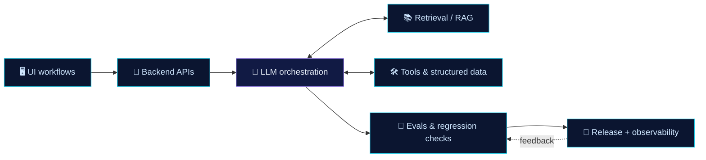

 

 

## 👋 About

I'm a software engineer working where **product, infrastructure, and AI** meet: full-stack product features, backend services, and LLM-powered capabilities, from design through release and production support.

- 🧠 **Applied AI:** LLM integration, retrieval, structured outputs, tool use, and the evaluation work that makes them dependable.
- 🧪 **AI training & evaluation:** reviewing model outputs and AI-generated code for correctness, robustness, and maintainability.
- 🏗️ **Full-stack & backend:** REST APIs, services, dashboards, and internal tools with reliable frontend–backend integration.
- 🌏 Based in **Pampanga, Philippines** · open to remote work.

> My work history, education, and background are on my **[portfolio site](https://roberamos1525.github.io/portfolio-website/)** and in my **[CV](https://roberamos1525.github.io/portfolio-website/Robert_Ramos_CV.pdf)**.

 

## 🧰 Tech Stack

<table>
<tr>
<td width="160"><b>Languages</b></td>
<td>

</td>
</tr>
<tr>
<td><b>Frontend</b></td>
<td>

</td>
</tr>
<tr>
<td><b>Backend</b></td>
<td>

</td>
</tr>
<tr>
<td><b>Applied AI</b></td>
<td>

</td>
</tr>
<tr>
<td><b>Cloud & DevOps</b></td>
<td>

</td>
</tr>
</table>

 

## 🛰️ How I Build AI Features

 

## ⚙️ Engineering Approach

| | Principle | In practice |
|:-:|---|---|
| **01** | **Own it end to end** | Architecture, implementation, testing, CI/CD, observability, release, and production support are one continuous responsibility. |
| **02** | **Evaluate, don't assume** | AI features deserve the same rigor as any production system: edge cases, structured outputs, fallbacks, and regression checks. |
| **03** | **Debug across boundaries** | Failures cross prompts, model behavior, APIs, data flows, and frontend state. Logs and reproducible cases find the real root cause. |

 

## 📌 Featured Project

<table>
<tr>
<td>

### [portfolio-website](https://github.com/roberamos1525/portfolio-website)

My personal portfolio: a responsive single-page site built with **React 19** and **Vite**, deployed on **GitHub Pages**. It has light and dark themes, scroll-reveal animations, an interactive experience timeline, and an animated SVG pipeline diagram.

</td>
</tr>
</table>

 

## 📊 GitHub Stats

 

## 🔭 Current Interests

- Evaluation methods for LLM features and AI-generated code
- Agentic workflows with dependable tool use and structured outputs
- Observability and safe rollout for AI-enabled products

## 🤝 Let's Connect

Interested in applied AI, full-stack product engineering, or AI training and evaluation work? Reach me at **[roberamos1525@gmail.com](mailto:roberamos1525@gmail.com)** or on **[LinkedIn](https://www.linkedin.com/in/robert-ramos-6507973b5)**.

 

  

